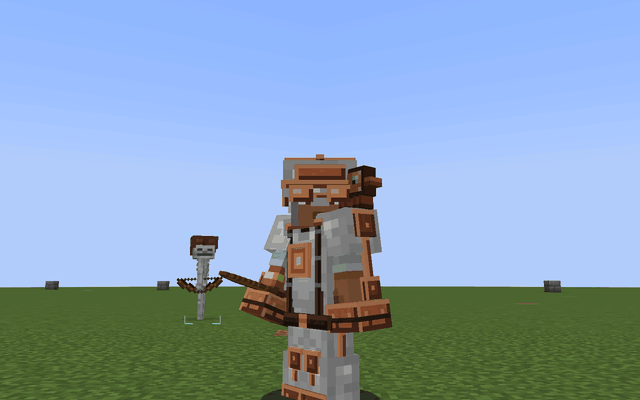

# Cogwit

A copper robot companion for Minecraft 1.21.1 on NeoForge.



Cogwit sits in your charm slot and rides on your shoulder. You feed him copper. In return he learns from every kind of damage you take and starts taking part of it off, and he keeps an eye on what you don't see coming, like the creeper behind you or the lava on the other side of the block you're mining.

- Brackets over hostile mobs, an arrow by the crosshair for threats behind you, and one short line above the hotbar for what he's thinking
- An ore scan that rolls out 32 blocks
- A slab that tears out of the ground to take hits and arrows aimed at your back
- Food, weapon swaps, an escape pearl and gear that gets put away before it breaks, but only what you allow
- Three brothers who jump down to fight next to you, and Overdrive in boss fights
- A copper exoframe, the Event Horizon armor, and trophies from 35 bosses in vanilla, L_Ender's Cataclysm, Twilight Forest, Bosses'Rise, Mowzie's Mobs, The Aether and Iron's Spells 'n Spellbooks

It's an alpha. It started as a helper for a co-op world, and so far two people have played it.

## Download

[Modrinth](https://modrinth.com/mod/cogwit) or the [releases](https://github.com/veowner/cogwit/releases) here. It goes on both the client and the server and needs [Curios API](https://modrinth.com/mod/curios) and [GeckoLib](https://modrinth.com/mod/geckolib). The boss mods, EMI, Create, Sophisticated Backpacks and Controlify are optional.

## Bugs and ideas

[Open an issue](https://github.com/veowner/cogwit/issues/new/choose). For a crash or anything that broke, attach `logs/latest.log` (or a link to it on [mclo.gs](https://mclo.gs)) and list your other mods.

## Building

Needs Java 21.

```bash
./gradlew build
```

The jar ends up in `build/libs/`. `./gradlew runGameTestServer` runs the in-game tests.

## License

[MIT](LICENSE), so you can put Cogwit in a modpack or build on the code as long as the license notice comes along. The Horizon armor sounds are Kenney's Sci-Fi Sounds (CC0).
